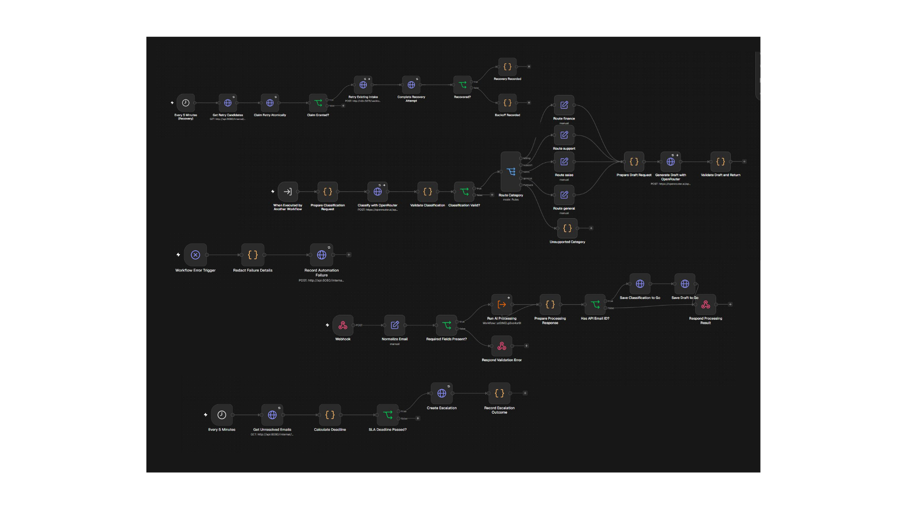
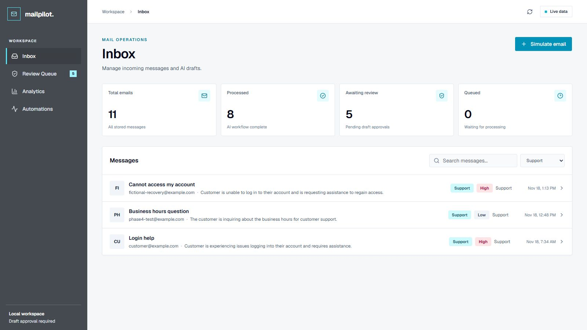
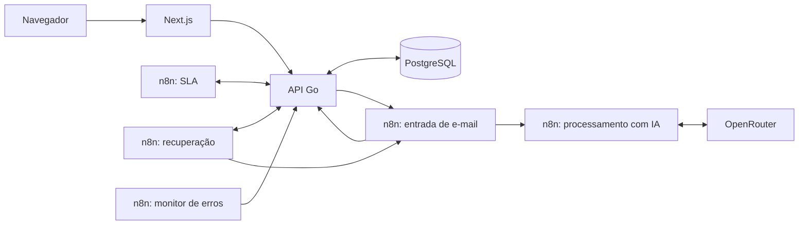
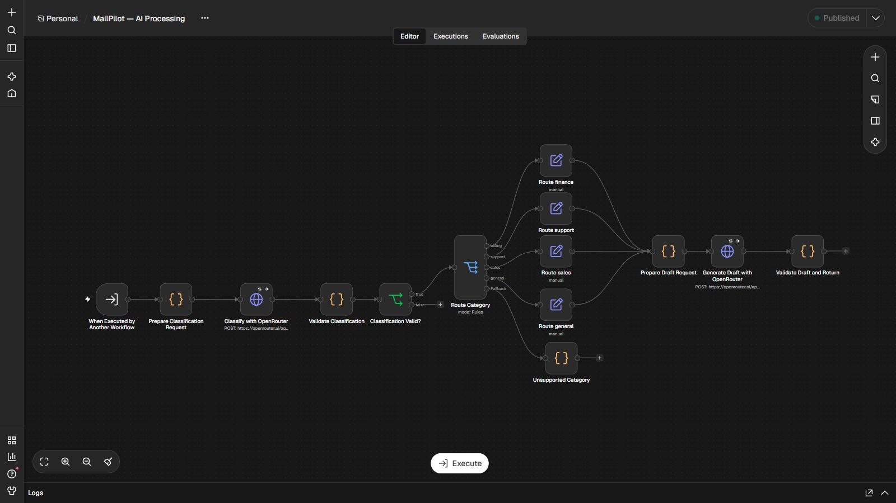
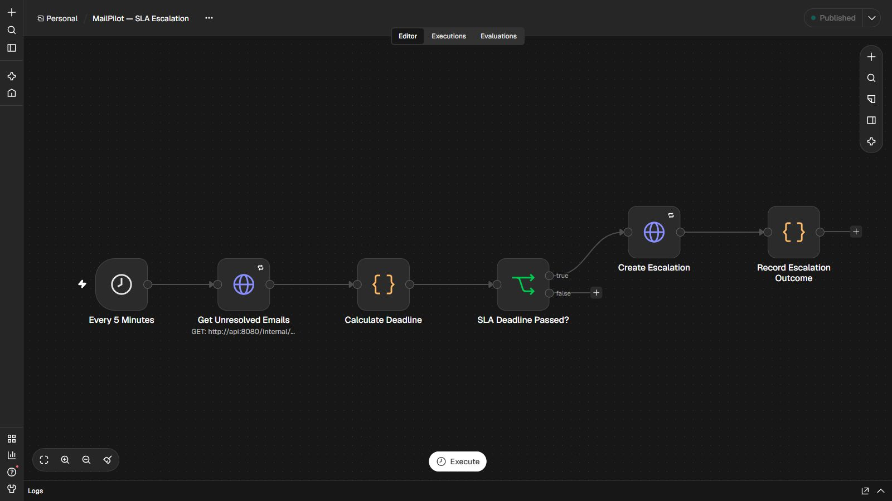
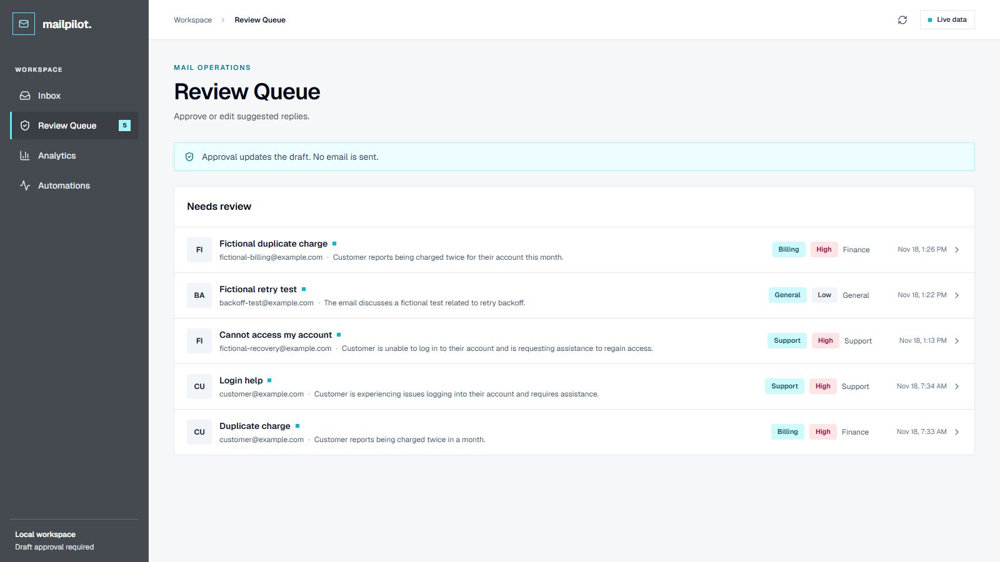
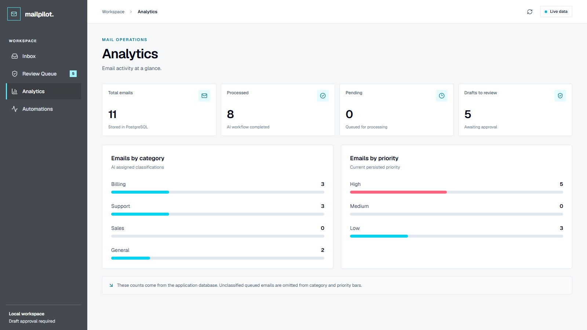
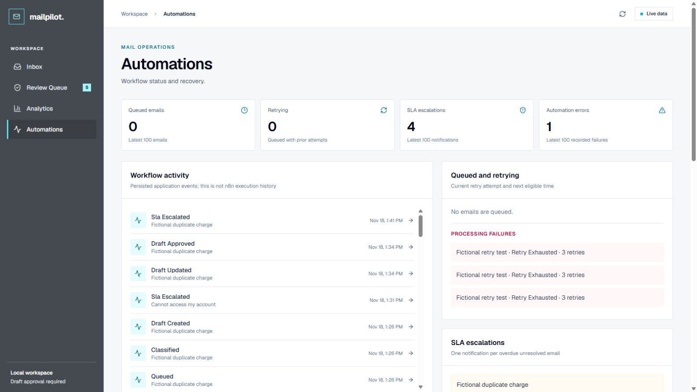
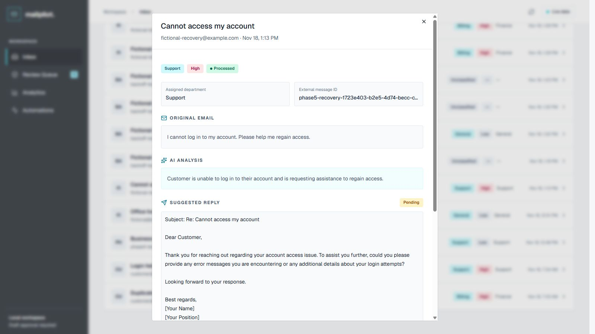

# MailPilot

MailPilot é uma prova de conceito de automação inteligente de e-mails.

O sistema recebe uma mensagem, usa IA para identificar assunto e prioridade, encaminha para o time correto e sugere uma resposta. A pessoa responsável pode revisar, editar, aprovar ou rejeitar o rascunho. **Nenhum e-mail é enviado automaticamente.**




## O que a demonstração mostra

- Inbox com classificação, prioridade, time responsável e resumo.
- Fila de revisão para rascunhos gerados pela IA.
- Analytics com dados reais salvos no PostgreSQL.
- Monitoramento de filas, tentativas, SLA e falhas.
- Recuperação automática quando o n8n fica indisponível.
- Cinco workflows n8n documentados com imagens reais do canvas.

## Acesso à demonstração

Use estas credenciais somente para a demonstração:

```text
E-mail: test@gmail.com
Senha: Password123!
```

Essas credenciais são de teste e não devem ser reutilizadas em nenhum outro serviço.

## Arquitetura



Em resumo: o Go salva o e-mail, o n8n coordena a automação, o OpenRouter fornece a IA e o dashboard mostra o resultado para revisão humana.

## Tecnologias

- Next.js, TypeScript, Tailwind CSS e shadcn/ui
- API REST em Go
- PostgreSQL
- n8n
- OpenRouter
- Docker Compose para desenvolvimento local

## Workflows n8n

As imagens foram capturadas do n8n e mostram os nós e suas conexões.

### Entrada de e-mail


Recebe o webhook, valida os campos e inicia o processamento. [JSON](n8n/workflows/01-email-intake.json)

### Processamento com IA



Classifica billing, support, sales ou general, define a prioridade, escolhe o time e gera o rascunho. [JSON](n8n/workflows/02-ai-processing.json)

### Escalonamento de SLA



Verifica mensagens atrasadas e cria uma notificação. [JSON](n8n/workflows/03-sla-escalation.json)

### Recuperação de mensagens em fila


Tenta novamente mensagens pendentes, com limite de tentativas e backoff. [JSON](n8n/workflows/04-queued-email-recovery.json)

### Monitor de erros


Registra falhas inesperadas sem salvar chaves ou o conteúdo completo do e-mail. [JSON](n8n/workflows/05-error-monitor.json)

## Telas da aplicação

| Inbox | Fila de revisão |
| --- | --- |
|  |  |

| Analytics | Automações |
| --- | --- |
|  |  |



## Como executar localmente

Pré-requisitos: Docker Desktop, Docker Compose, Node.js e npm.

```powershell
Copy-Item .env.example .env
docker compose up -d --build

cd apps/web
npm install
npm run dev
```

Abra o [dashboard](http://localhost:3000), o [n8n](http://localhost:5678) ou a [API](http://localhost:8080/health).

Os volumes do Docker preservam os dados do n8n e do PostgreSQL. Não use `docker compose down -v` se quiser manter os dados.

## Configuração do n8n e deploy

Em uma instalação nova, importe os cinco arquivos JSON de `n8n/workflows/` e configure sua própria credencial Header Auth do OpenRouter nos dois nós de IA. As chaves não ficam nos arquivos exportados.

Para implantação em nuvem, consulte [docs/DEPLOYMENT.md](docs/DEPLOYMENT.md). O guia explica Vercel, Railway, variáveis de ambiente, autenticação e rede privada.

## Testes

```powershell
docker run --rm -v "${PWD}/services/api:/src" -w /src golang:1.25-alpine go test ./...

cd apps/web
npx tsc --noEmit
npm run lint
npm run build
```

Também existem testes de integração em `n8n/tests/`, incluindo o fluxo real Go → n8n → OpenRouter → PostgreSQL.

## Limitações da prova de conceito

- O envio real de e-mails está desativado.
- A autenticação é simples e voltada para demonstração.
- O projeto ainda precisa de configuração de produção, backups e observabilidade de uma aplicação pública.
- Os dados da demonstração são fictícios.

## Estrutura principal

```text
apps/web/              Dashboard Next.js
services/api/          API Go e migrations
n8n/workflows/         Workflows exportados
n8n/tests/              Testes de integração
docs/images/           Imagens do dashboard e dos workflows
docker-compose.yml     Ambiente local
```
