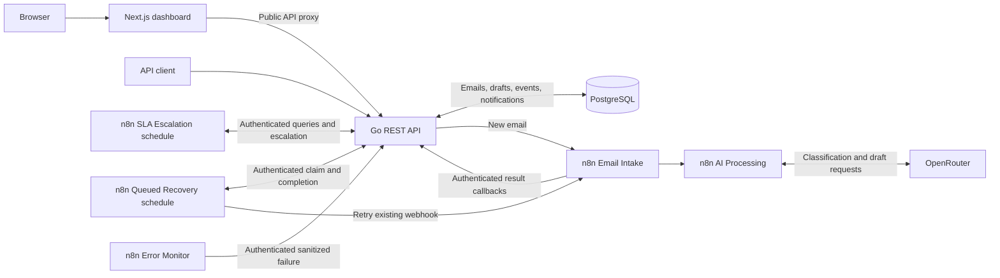
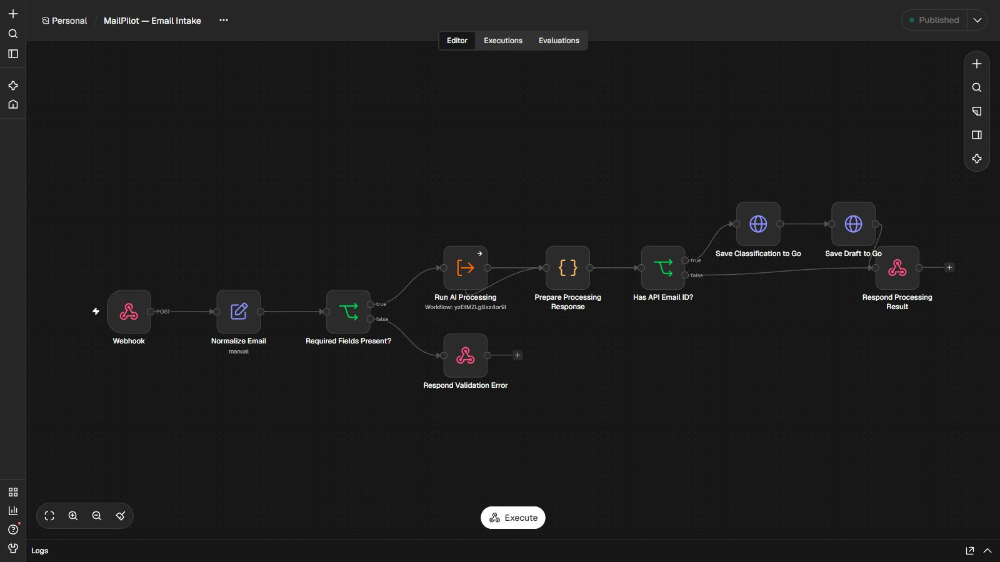
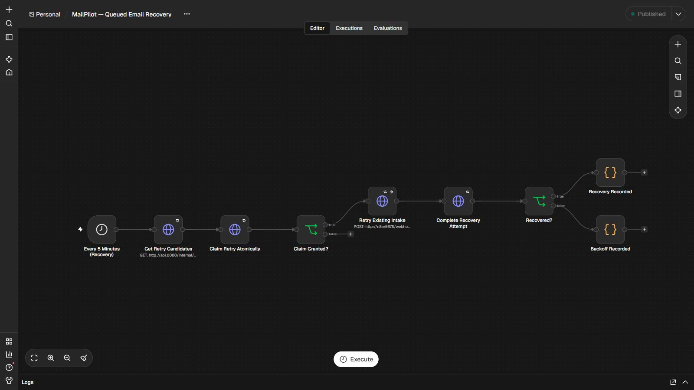
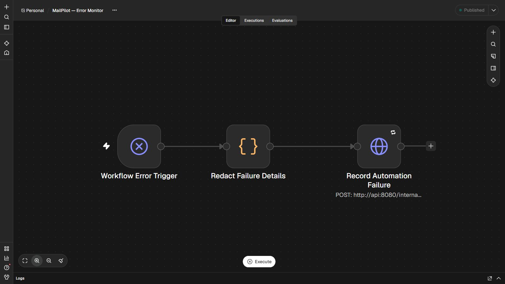

# MailPilot

MailPilot is a local email operations demo. Next.js lets an operator inspect messages, review AI drafts, and monitor automation. Go and PostgreSQL own application data; n8n orchestrates classification, routing, draft generation, SLA escalation, recovery, and error monitoring. OpenRouter is called from n8n. Approval never sends an email.


## Key features

- Inbox with stored classification, priority, department, summary, draft, and event timeline.
- Review Queue for editing, approving, or rejecting drafts without sending them.
- Analytics calculated from PostgreSQL records.
- Automations page for queued and exhausted emails, retry activity, SLA notices, and sanitized workflow failures.
- Five published n8n workflows with real canvas screenshots below.
- Idempotent email creation, SLA notifications, workflow events, and bounded recovery attempts.

## System architecture



Go persists emails before calling n8n. If n8n is unavailable, the email remains queued. The scheduled recovery workflow claims eligible records and calls the **same** published intake webhook. Intake calls AI Processing, then saves classification and draft through authenticated Go callbacks. Direct intake webhook calls retain the Phase 2 response format; without a Go `email_id`, they do not create an application record.

## Technology stack

| Layer | Implementation |
| --- | --- |
| Dashboard | Next.js 16 App Router, TypeScript, Tailwind CSS, shadcn/ui, Lucide |
| API | Go standard library HTTP server, pgx PostgreSQL driver |
| Application database | PostgreSQL 17 |
| Automation | n8n 2.48.5, stored in its existing Docker volume |
| AI | OpenRouter, accessed by two n8n HTTP Request nodes |
| Local runtime | Docker Compose for n8n, API, and PostgreSQL; Next.js runs separately |

## How MailPilot works

1. `POST /emails` validates and stores a unique `external_message_id` with `queued` status.
2. Go calls the published n8n intake webhook with the database email ID.
3. n8n validates input, runs AI Processing, routes billing/support/sales/general to finance/support/sales/general, and generates a suggested reply through OpenRouter.
4. Authenticated callbacks save the classification and one draft. The caller receives HTTP 201 with the stored result, or HTTP 202 if processing has not finished.
5. An operator can edit or approve/reject a draft. Approved and rejected drafts are **resolved** for SLA purposes. Missing or pending drafts are **unresolved**.
6. n8n schedules check unresolved deadlines and retry eligible queued emails. Unexpected workflow failures reach Error Monitor.

## n8n Workflow Gallery

These are screenshots of the **published workflows in the running local n8n editor**, captured at 1600 × 900. They show canvas nodes and connections, without node parameter panels or credential values. The repository JSON files were synced from the published workflow export.

### 1. Email Intake



**Trigger:** Published `POST /webhook/mailpilot-intake`. **Purpose:** Normalize and validate email input, call AI Processing, persist Go callbacks when an email ID is present, and preserve the Phase 2 webhook response. **Key nodes:** Webhook, Required Fields Present?, Run AI Processing, Save Classification to Go, Save Draft to Go, Respond Processing Result. **Errors:** Invalid required fields use the normal HTTP 400 branch; unexpected execution failures use Error Monitor. **Workflow JSON:** [01-email-intake.json](n8n/workflows/01-email-intake.json).

### 2. AI Processing


**Trigger:** Called by Email Intake. **Purpose:** Classify category and priority, route to a department, and generate a reply draft. **Key nodes:** Classify with OpenRouter, Validate Classification, Route Category, Generate Draft with OpenRouter, Validate Draft and Return. **Errors:** Invalid classification or draft stops a successful response; unexpected execution failures use Error Monitor. **Workflow JSON:** [02-ai-processing.json](n8n/workflows/02-ai-processing.json).

### 3. SLA Escalation


**Trigger:** Schedule Trigger every five minutes. **Purpose:** Read unresolved emails and compare their computed deadline with the current time. **Key nodes:** Get Unresolved Emails, Calculate Deadline, SLA Deadline Passed?, Create Escalation, Record Escalation Outcome. **Errors:** HTTP request nodes retry transient failures; unexpected execution failures use Error Monitor. Go rechecks the deadline and draft state in a transaction and creates one notification plus one event per email. **Workflow JSON:** [03-sla-escalation.json](n8n/workflows/03-sla-escalation.json).

### 4. Queued Email Recovery



**Trigger:** Schedule Trigger every five minutes. **Purpose:** Retry eligible queued or retryable emails through the existing published intake webhook. **Key nodes:** Get Retry Candidates, Claim Retry Atomically, Claim Granted?, Retry Existing Intake, Complete Recovery Attempt, Recovered?. **Errors:** Go enforces an atomic lease, bounded attempts, and backoff; a failed intake attempt records a recovery event. Unexpected workflow failures use Error Monitor. **Workflow JSON:** [04-queued-email-recovery.json](n8n/workflows/04-queued-email-recovery.json).

### 5. Error Monitor



**Trigger:** n8n Error Trigger for the other four workflows. **Purpose:** Record an unexpected workflow failure and create an internal notification. **Key nodes:** Workflow Error Trigger, Redact Failure Details, Record Automation Failure. **Errors:** The callback retries transient HTTP failures; the saved message is a generic classification of the error, not the raw error text or email body. **Workflow JSON:** [05-error-monitor.json](n8n/workflows/05-error-monitor.json).

## Application Screenshots

These screenshots show the running dashboard with fictional local test records. The numbers are database values at capture time, not static UI fixtures.

| Inbox | Review Queue |
| --- | --- |
|  |  |

| Analytics | Automations |
| --- | --- |
|  |  |

[Email detail with the stored draft and AI analysis](docs/images/dashboard/email-detail.png) · [Automation errors and internal notifications](docs/images/dashboard/automations-detail.png)

## Getting started

Requirements: Docker Desktop with Linux containers, Docker Compose, Node.js and npm. Ports `3000`, `5678`, and `8080` must be available on localhost.

```sh
cp .env.example .env
# Replace POSTGRES_PASSWORD and MAILPILOT_INTERNAL_TOKEN with different random values.
docker compose up -d --build
docker compose ps
cd apps/web
npm install
npm run dev
```

In PowerShell, copy with `Copy-Item .env.example .env`; run the other commands in the same order. Open the dashboard at [http://localhost:3000](http://localhost:3000) and n8n at [http://localhost:5678](http://localhost:5678). The Go API is at `http://localhost:8080`. Migrations run when the API starts. Docker volumes `n8n_data` and `postgres_data` preserve credentials and records across restarts; do not use `docker compose down -v` to stop this project. For an authenticated local production-style dashboard, also copy `apps/web/.env.example` to `apps/web/.env.local` and use the same frontend token as the API. `npm run dev` remains open only when the demo-login variables are absent; production builds always require demo authentication and the shared Go secret.

For a **new n8n installation**, import the five JSON files in `n8n/workflows/`, bind the two OpenRouter HTTP nodes to your own n8n Header Auth credential, set the other four workflows' **Error Workflow** setting to MailPilot — Error Monitor, and publish all five. The exported JSON contains a local credential reference, not a key; a new instance needs its own credential binding. The existing local instance is already configured and published. Verify the production webhook path before sending requests; importing a duplicate intake workflow can conflict with the same path.

To run the built dashboard instead of the dev server, use `npm run build` and `npm run start` from `apps/web`.

## Deployment

MailPilot is prepared for a protected Vercel dashboard, Railway Go API/PostgreSQL/n8n services, and private service-to-service networking. Deployment creates cloud resources and requires fresh secrets, so it is intentionally not performed by the repository setup. Follow the complete [Vercel + Railway deployment guide](docs/DEPLOYMENT.md), including its environment reference, protected n8n import steps, and verification checklist.

## Environment configuration

| Variable | Purpose | Local default |
| --- | --- | --- |
| `POSTGRES_PASSWORD` | PostgreSQL password in Compose | Required in `.env` |
| `MAILPILOT_INTERNAL_TOKEN` | Shared n8n → Go callback token | Required in `.env` |
| `MAILPILOT_TIMEZONE` | n8n timezone | `America/Chicago` |
| `MAILPILOT_SLA_HIGH_SECONDS` | High priority response deadline | `900` (15 minutes) |
| `MAILPILOT_SLA_MEDIUM_SECONDS` | Medium priority response deadline | `3600` (1 hour) |
| `MAILPILOT_SLA_LOW_SECONDS` | Low priority response deadline | `14400` (4 hours) |
| `MAILPILOT_MAX_RETRY_ATTEMPTS` | Maximum scheduled recovery claims | `3` |
| `MAILPILOT_RETRY_BASE_SECONDS` | Exponential backoff base | `30` |
| `MAILPILOT_RETRY_LEASE_SECONDS` | Atomic processing lease | `90` |
| `GO_API_URL` | Server-side Next.js proxy target, in `apps/web/.env.local` | `http://127.0.0.1:8080` |

Keep `.env` and `apps/web/.env.local` out of version control. For a short local SLA demonstration, set `MAILPILOT_SLA_HIGH_SECONDS=60` in `.env`, restart the API with `docker compose up -d --build api`, create a fictional high priority email, and run the SLA workflow after the deadline. Classification determines priority, so inspect the stored result first. The five-minute schedule can add up to five minutes before escalation.

## API overview

| Method and path | Purpose |
| --- | --- |
| `POST /emails` | Validate, persist, and trigger the intake workflow; idempotent external message ID |
| `GET /emails`, `GET /emails/{id}` | List and inspect stored emails and drafts |
| `GET /emails/{id}/events` | Per-email application workflow timeline |
| `PATCH /emails/{id}/draft` | Edit, approve, or reject a stored draft |
| `GET /analytics`, `GET /workflow-events` | Database-backed dashboard summaries |
| `GET /notifications`, `GET /automation-errors` | Persisted reliability activity |
| `GET /health` | API and database health |

Internal endpoints under `/internal/` save classification and drafts, query unresolved and retry eligible emails, claim and complete retries, escalate overdue emails, and record failures. They require the `X-MailPilot-Token` header. The Next.js proxy only allows the public routes above and returns 404 for internal routes.

```sh
curl -i -X POST http://localhost:8080/emails \
  -H "Content-Type: application/json" \
  -d '{"external_message_id":"example-unique-001","sender":"fictional@example.com","subject":"Billing question","body":"I have a question about an invoice."}'
curl http://localhost:8080/emails
curl http://localhost:8080/notifications
```

To test the original direct webhook, run `curl -i -X POST http://localhost:5678/webhook/mailpilot-intake -H "Content-Type: application/json" --data-binary @n8n/sample-email.json` from the repository root. Use `curl.exe` on Windows PowerShell. To inspect stored records directly, run `docker compose exec db psql -U mailpilot -d mailpilot -c "SELECT id,subject,category,processing_status,retry_attempts FROM emails ORDER BY created_at DESC LIMIT 10;"`.

## Reliability and error handling

**SLA.** A draft that is missing or `pending` is unresolved; `approved` and `rejected` are resolved. Go computes `created_at + priority threshold`, n8n decides whether to escalate, and Go checks again while locking the email. A unique idempotency key prevents repeat SLA notifications and events. The scheduler skips already escalated emails on later scans.

**Recovery.** A queued, `ai_failed`, or `draft_failed` email becomes eligible at `next_retry_at`. Go atomically claims it, increments `retry_attempts`, and grants a time-limited claim token. n8n retries the published intake URL using the original external message ID and Go email ID. Completion checks that a draft and a `processed` or `needs_review` classification really exist before declaring success. Failures wait `30`, `60`, then `120` seconds with the default base; after three scheduled claims the status becomes `retry_exhausted` and one notification is stored. The five-minute schedule may delay an otherwise eligible attempt. Database uniqueness prevents duplicate drafts and events.

**Error monitoring.** n8n's Error Trigger receives unexpected workflow failures. The workflow sends only IDs and a generic error category/message to Go. Go stores an `automation_failures` row and an internal notification with a stable idempotency key. Expected email validation returns HTTP 400 through the intake workflow's normal branch and is not an automation failure. The Automations page labels its timeline as **application workflow events**, not n8n execution history.

To simulate downtime manually in this local environment, stop only n8n with `docker compose stop n8n`, then create a fictional email through `POST /emails`. The API should return HTTP 202 and the record should remain queued. Start n8n with `docker compose start n8n`; after the next recovery schedule (or a manual execution of **MailPilot — Queued Email Recovery**), check `GET /emails/{id}`, its events, and `/notifications`. Do not stop the API or database for this scenario.

## Testing

```sh
docker run --rm -v "${PWD}/services/api:/src" -w /src golang:1.25-alpine go test ./...
cd apps/web
npx tsc --noEmit
npm run lint
npm run build
```

From the repository root on PowerShell, run `pwsh -NoProfile -File n8n/tests/phase5-live-smoke.ps1` for a **real** Go → n8n → OpenRouter → PostgreSQL request and direct webhook checks. Run `pwsh -NoProfile -File n8n/tests/phase5-retry-integration.ps1` for a **fixture-driven** three-attempt backoff and exhaustion check. Both scripts create fictional records; the retry fixture intentionally bypasses OpenRouter to exercise failure handling. Tests do not clear the database.

Verification on **18 November 2026**: Go tests, TypeScript, lint, and production build passed. The live smoke run returned HTTP 201 for a billing email routed to finance with a nonempty stored draft; GET returned processed; duplicate POST returned 200 with the same ID; invalid API and direct webhook inputs returned 400; direct intake returned 200 with a real OpenRouter draft; unauthenticated internal access returned 401 and the Next.js internal proxy returned 404. Editing and approving that stored draft persisted the text and approval state, with `draft_updated` and `draft_approved` events. A live n8n recovery execution processed a fictional support email with one draft, and a second run made no duplicate. Two live SLA runs resulted in one escalation notice per overdue email; approved and rejected drafts had none. An actual unexpected n8n failure appeared in Automations through Error Monitor. The fixture check observed approximately 30/60/120-second backoff, immediate claim rejection (409), and one exhaustion notice. An automated n8n stop was blocked by approval review, so the full **n8n down → queued → service restored** sequence remains unverified.

## Security considerations

- This is a **local demo**, not a public deployment. Compose binds n8n and Go to `127.0.0.1`; the Next.js dev server may listen on other interfaces by default.
- The deployment configuration protects the dashboard and Next.js API proxy with Auth.js sessions, and protects Go public application routes with a separate server-to-server secret. Local development keeps its original behavior if `MAILPILOT_FRONTEND_TOKEN` is not set; production refuses to start without it.
- The internal token protects workflow callbacks, but n8n can read it from its container environment so its HTTP nodes can authenticate. Keep Docker host and n8n owner access restricted.
- OpenRouter keys live only in n8n credentials. Exported workflow JSON and screenshots contain no API key or credential value.
- Incoming email bodies are rendered as text, not untrusted HTML. Error Monitor does not persist raw error text or email bodies.
- Draft approval is a database state change. No workflow sends an email automatically.

## Project structure

```text
apps/web/                  Next.js dashboard and allowlisted API proxy
services/api/cmd/api/      Go handlers, reliability logic, and tests
services/api/migrations/   PostgreSQL schema and reliability migration
n8n/workflows/             Five published workflow exports and sync helper
n8n/tests/                 Live smoke and retry fixture scripts
n8n/sample-email.json      Fictional direct webhook example
docs/images/workflows/     Five real n8n canvas screenshots
docs/images/dashboard/     Real application screenshots
docker-compose.yml         n8n, PostgreSQL, and Go API
```

## Future improvements

Authentication and authorization for operators, a durable asynchronous API job queue, pagination for larger email volumes, configurable SLAs per customer, and delivery through an explicitly approved outbound email channel are outside this local demo.
